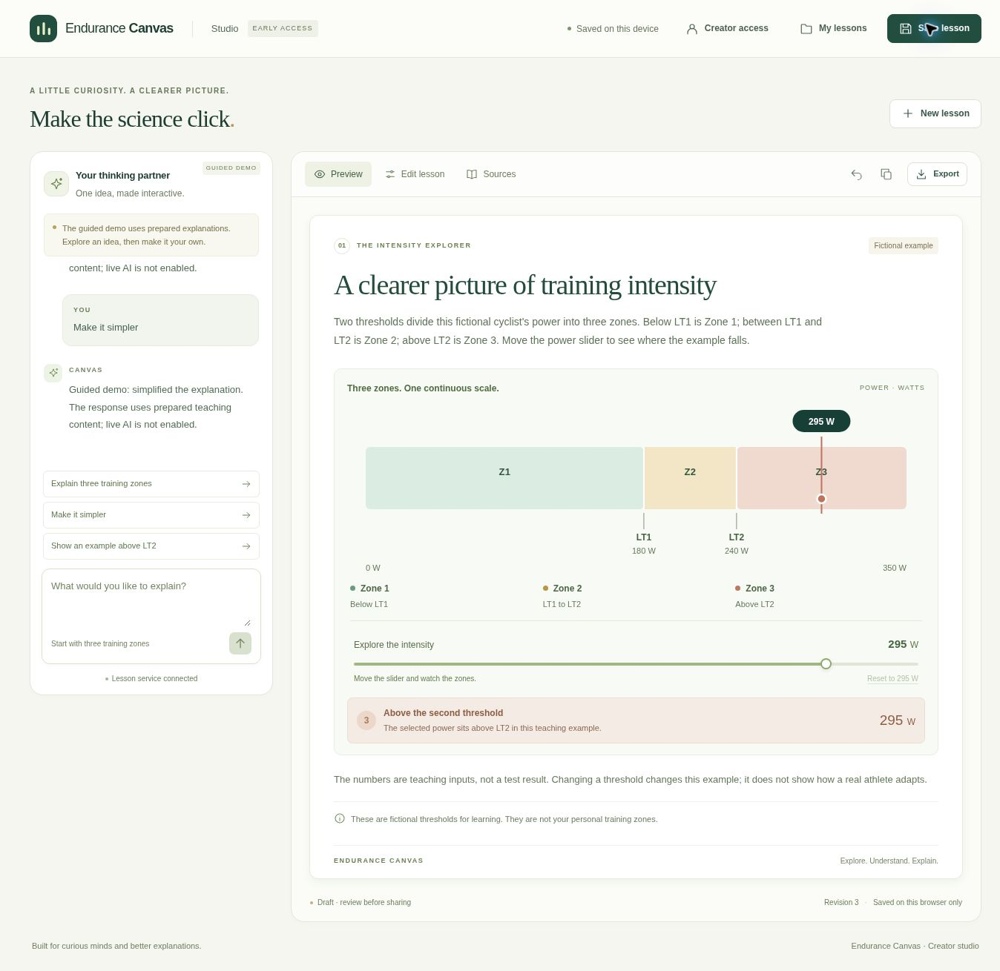

# Endurance Canvas — project guide

**Explore, understand, and explain endurance.**

Endurance Canvas helps Milan build interactive explanations of endurance physiology. The first studio combines a guided conversation with an editable three-zone lesson, a working power control, visible assumptions, and sources. Reviewed lessons can later become public learning pages on the coaching website.

**Status: creator access and protected AI implementation, 3 November 2026.** The public studio still includes browser drafts, editing, revisions, JSON backups, PNG export, and the guided demo. This release adds one-owner access and persistent AI request allowances, verified with a real database in CI. Hosted authentication and real AI remain pending the setup gates in [Activation](06-creator-and-ai-activation.md). See [Progress](04-progress.md) for the verified release and deployment evidence.

## Try the studio

Open **[Endurance Canvas](https://endurance-canva-frontend.vercel.app/)**. Choose “Explain three training zones,” explore the suggestion, and click “Use this version.” Then try “Show an example above LT2” or edit the title and fictional thresholds yourself. Save the lesson, reopen the page, and use Export for a JSON backup or PNG visual summary.

The studio is accessible without a login. Live AI is a separate owner-only mode that stays unavailable until its connection is activated. Drafts are stored in that browser, so use JSON export to keep a separate copy or move a lesson to another device.

## Project documents

| Document | What it answers |
| --- | --- |
| [01 — Product and scope](01-product-and-scope.md) | Who the app serves, how it should feel, and what belongs in the first version. |
| [02 — Architecture and stack](02-architecture-and-stack.md) | Technologies, repository responsibilities, AI/data flow, and the proposed API contract. |
| [03 — Features and build plan](03-features-and-build-plan.md) | Ordered milestones, feature checkboxes, and acceptance criteria. |
| [04 — Progress](04-progress.md) | What is actually complete, what is next, and decisions still to make. |
| [05 — Quality and publishing](05-quality-and-publishing.md) | Scientific review, practical verification, operating limits, and the later website/public release. |
| [06 — Creator and AI activation](06-creator-and-ai-activation.md) | Exact setup steps, current access blockers, environment settings, and the real-model acceptance gate. |

## The three repositories

| Repository | Responsibility |
| --- | --- |
| [endurance-canva-frontend](https://github.com/mkmilan/endurance-canva-frontend) | Mobile-friendly studio, conversation interface, interactive renderer, local drafts, and exports. |
| [endurance-canva-backend](https://github.com/mkmilan/endurance-canva-backend) | Validated generation/refinement, trusted lesson/source catalogues, and later durable storage. |
| [endurance-canva-dosc](https://github.com/mkmilan/endurance-canva-dosc) | Canonical product plan, architecture decisions, feature checklist, and progress. |

The product name is **Endurance Canvas**. Repository URLs retain the existing `endurance-canva-*` spelling, including `-dosc`. Use these exact URLs in links and Git remotes.

## First useful result

Milan asks for a beginner explanation of three training zones, explores an interactive example, requests a meaningful refinement, and saves a version worth sharing. Start with one excellent lesson type. More lesson types extend the same studio after that full workflow works.

The stack is plain JavaScript, Next.js, Tailwind, React/SVG visuals, and a separate Node/Express backend. Validated lesson data selects tested components; the diagram responds locally without generation requests. Drafts stay in the browser with JSON backups. Milan selected Vercel and Render for testing. Better Auth with MongoDB stores owner sessions and usage; cloud lesson saving is a later feature.

## Continuing work

Read [Progress](04-progress.md) first, then the next milestone in [Features and build plan](03-features-and-build-plan.md). Treat unchecked features as planned. Update the checklist and progress when an implementation has evidence behind it; link the relevant frontend/backend commits. Keep each repository independently runnable once its scaffold exists.

The next product checkpoint is **M2's real-model demonstration**: activate the database connection, finish owner setup, connect a Gateway key, and evaluate the prepared prompt set. A supported prompt should produce a useful lesson, a follow-up should meaningfully refine it, and failures must preserve the draft. Fixture verification does not complete this checkpoint.
